# 画中杀境操作手册

适用文件：本仓库 `index.html`，由用户提供的《画中杀境.html》原样复制。整理日期：2026-11-16。

**在线入口：** https://charleswang505.github.io/huazhong-shajing-web/  
**GitHub 仓库：** https://github.com/CharlesWang505/huazhong-shajing-web

> 本手册描述此 HTML 的实际行为，不是外部游戏的官方规则说明。截图为真实浏览器操作；牌面、商店候选、推荐与概率是当次示例，不要求与你的结果相同。

## 目录

- [一、打开与快速上手](#一打开与快速上手)
- [二、认识规则与增益](#二认识规则与增益)
- [三、关卡试炼完整流程](#三关卡试炼完整流程)
- [四、关卡辅助完整流程](#四关卡辅助完整流程)
- [五、辅助墨市与调牌](#五辅助墨市与调牌)
- [六、截图识别与 API 设置](#六截图识别与-api-设置)
- [七、概率与推荐怎么看](#七概率与推荐怎么看)
- [八、存档、手机与常见问题](#八存档手机与常见问题)
- [九、GitHub 发布与后续更新](#九github-发布与后续更新)
- [十、验证范围](#十验证范围)

## 一、打开与快速上手

### 1. 在线打开

在桌面 Chrome 或 Edge 打开上面的在线地址。基础功能也可在手机浏览器操作；窗口共享识别优先使用桌面浏览器。

首页有两个主要入口：

| 入口 | 适合做什么 | 操作发生在哪里 |
| --- | --- | --- |
| 关卡试炼 | 练习选牌、挑战九境战役、购买增益 | 完全在本网页内结算 |
| 关卡辅助 | 根据另一款游戏的实际手牌与增益获得建议 | 本网页记账、推演；外部游戏仍须手动执行 |
| 先读规则 / 规则 | 查看次数、目标分、墨卷和观星规则 | 弹出规则窗口 |
| 增益图鉴 | 查阅增益效果与触发条件 | 弹出图鉴 |


### 2. 三分钟跑通试炼

1. 点击「关卡试炼」。
2. 在关卡画卷点击当前可用的「开始战役」。
3. 点击「参谋推荐」，查看已选牌与预计伤害。
4. 点击「出牌 · 造成伤害」，等本次结算完成。
5. 继续选牌出牌；组合不好时，选中要丢的牌，再点「弃牌补牌」。
6. 达标后进入墨市，购买增益，再在丰富 / 精简牌库中选择一种调整方式。

### 3. 离线打开

在 GitHub 仓库点击 **Code → Download ZIP**，解压，双击 `index.html`。不要直接在压缩包预览里运行。

试炼、手动录牌、本地推荐与模拟不需要 API。截图识别需要网络与自备的兼容服务；本地文件的窗口共享或 CORS 受浏览器限制时，改用 HTTPS 在线版或手动录牌。

## 二、认识规则与增益

### 1. 基础资源

| 项目 | 初始规则 |
| --- | --- |
| 手牌 | 8 张 |
| 每关出牌 | 6 次，部分增益可能改变消耗 |
| 每关弃牌 | 6 次，部分增益可能提供额外效果 |
| 每次选牌 | 1 至 6 张，再点一次取消选中 |
| 出牌后 | 结算伤害，打出的牌入弃牌堆，补至 8 张 |
| 弃牌后 | 弃掉选中的牌并补牌，不消耗出牌次数 |
| 抽牌堆耗尽 | 将弃牌堆重新洗入抽牌堆 |

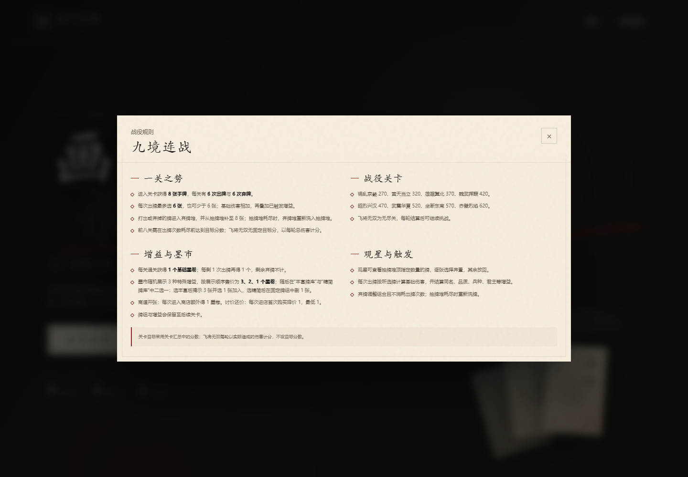

### 2. 卡牌与伤害

此版本基础牌组有 **44 张、15 种牌**。赤色武将基础伤害 6，橙色武将 3，青色兵牌 1。兵种包括弓、骑、枪、盾；不要只凭颜色或分数判断牌型。

| 基础类别 | 牌名与初始牌数 |
| --- | --- |
| 赤色 | 曹操 ×1、刘备 ×1、孙权 ×1、吕布 ×3、关羽 ×3 |
| 橙色 | 张飞 ×4、袁绍 ×3、孙策 ×3、周瑜 ×3、黄盖 ×3、吕蒙 ×3 |
| 青色 | 弓兵、骑兵、枪兵、盾兵各 ×4 |

每次伤害为所选牌的基础点数与已触发增益之和。不同条件可以同时触发，右侧预览会列出本次基础、增益和总伤害。

初始增益的常见例子：3 张同名 +20；3 张同兵种 +10；3 张赤色 +30、橙色 +20、青色 +10；刘备 + 孙权 + 曹操触发「三分天下」+80。实际触发以当前持有增益和预览为准，不要把尚未购买的特殊增益算进去。

例如本手册图 5 的 6 张牌，基础点数为 27，赤色 +30、橙色 +20、同骑兵 +10，合计 **87**。

### 3. 查增益与观星

点击首页「增益图鉴」，或战役中的「增益」，查看各项条件。进入后续关卡，已经获得的增益会保留。

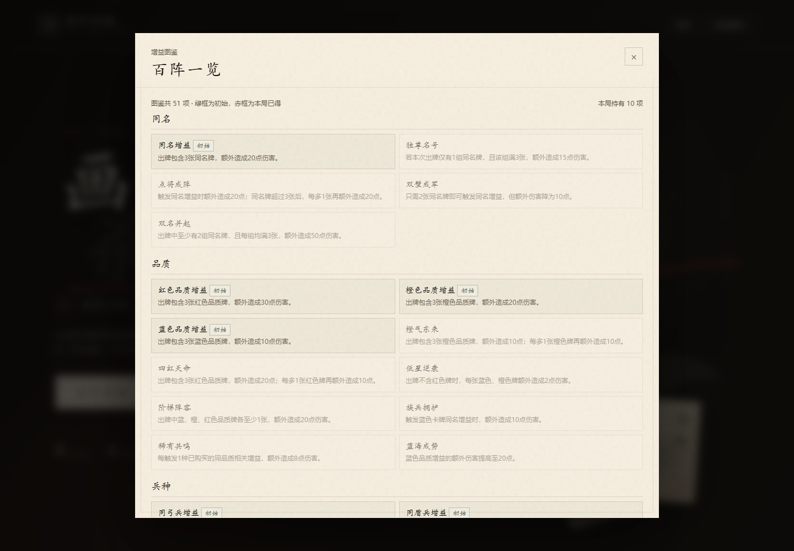

持有观星相关增益时，会弹出「抽牌堆顶」窗口。点击牌面将它标记为弃置；未标记的牌按原顺序放回。可以先点「参谋推荐」生成标记，但仍需点击「放回未选 · 弃置已选」确认，不是点推荐就自动执行。

## 三、关卡试炼完整流程

### 1. 选关与开始

战役按顺序推进，当前关卡可挑战，后续关卡在前关通过后开放。存在进度时会显示继续入口。

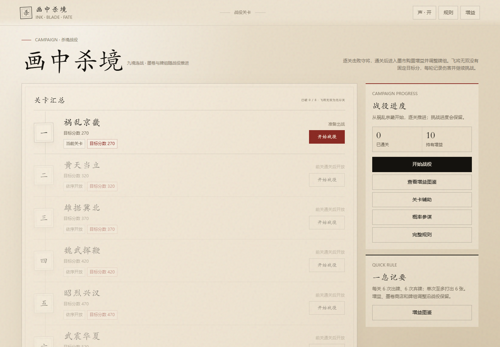

| 顺序 | 关卡 | 目标分数 |
| --- | --- | --- |
| 1 | 祸乱京畿 | 270 |
| 2 | 黄天当立 | 320 |
| 3 | 雄据冀北 | 370 |
| 4 | 魏武挥鞭 | 420 |
| 5 | 昭烈兴汉 | 470 |
| 6 | 武震华夏 | 520 |
| 7 | 坐断东南 | 570 |
| 8 | 赤壁烈焰 | 620 |
| 9 | 飞将无双 | 无固定目标，每轮固定 6 次出牌，以总伤害计分 |

「重开战役」会要求确认，并重新开始战役，重置该轮牌组、增益、墨卷等进度。不要把它当作普通返回按钮。

### 2. 选牌、出牌、弃牌

1. 点击一张牌使其高亮，最多选 6 张；再次点击取消。
2. 看右侧「本次出牌 · 预计伤害」，核对基础和增益。
3. 需要直接出手，点「出牌 · 造成伤害」。结算完成再进行下一次操作。
4. 需要换牌，先选择要丢弃的牌，再点「弃牌补牌」。它扣弃牌次数，不扣出牌次数，也不因保留弃牌次数增加墨卷。
5. 不确定组合时点「参谋推荐」。试炼中的这个按钮会选中推荐牌，但不会自动出牌。
6. 顶栏「参谋」用于概率与预估，不等同于直接选牌的按钮。

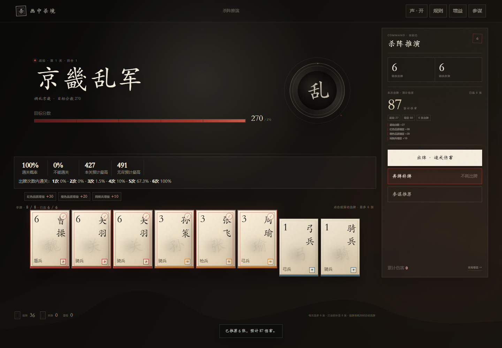

### 3. 通关与失败

前八关在次数耗尽前达到目标即通关；未达到则失败，可选择「再战本关」。未结束时点左上角标题离开，会出现确认，放弃本次战斗；这与刷新恢复不是一回事。

通关后墨卷基础奖励为 **1 + 剩余出牌次数**。剩余弃牌不计入奖励，其他奖励增益另行结算。

图 6 的当次记录：伤害 278，剩 1 次出牌，得到 2 墨卷。不要照抄这个结果作为必然收益。

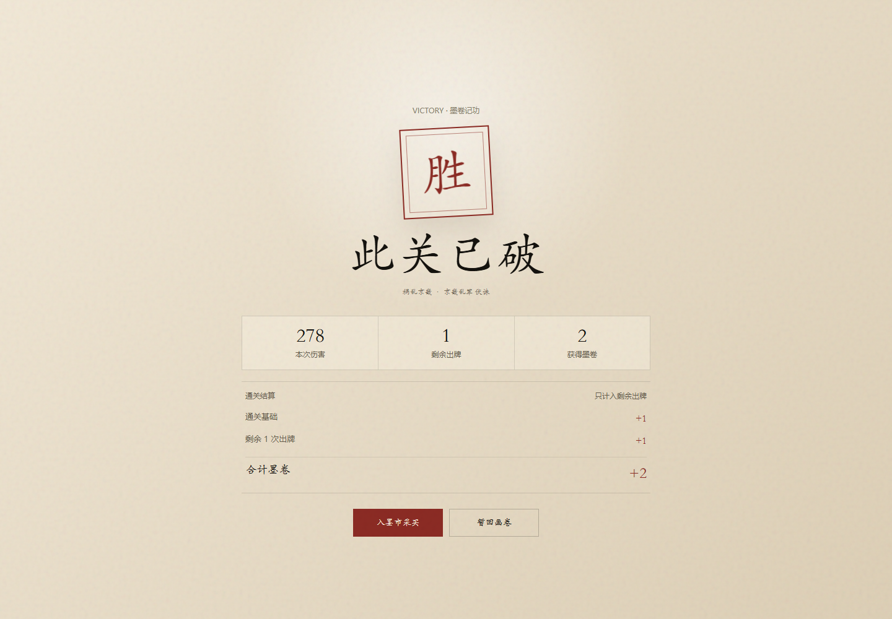

### 4. 墨市购买

1. 在结算页点击「入墨市采买」。
2. 查看三张特殊增益、触发条件、价格与可用墨卷。
3. 按展示顺序基础价格为 **3、2、1 墨卷**；若有讨价还价等增益，以画面显示的实际价格为准。
4. 点击「购入」会真实修改本次网页试炼的墨卷和增益，买过的档位会换出候选。余额不足会阻止购买。
5. 「推荐购买」可以提供方案，但不要求把墨卷花光。
6. 结束时点击「结束购买 · 调整牌组」。

「商道开张」和「讨价还价」是特定增益的效果，**没有持有时不会自动生效**，不要仅凭商店底部的提示理解为人人都有。

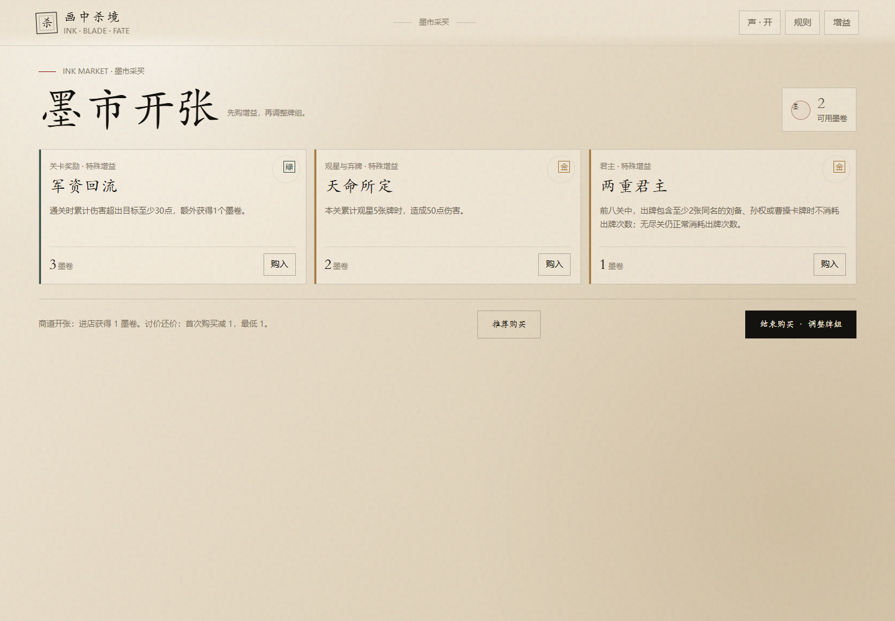

### 5. 丰富或精简牌库

每次进入调牌阶段只能二选一。可以跳过，不允许先看完丰富候选再切到精简。

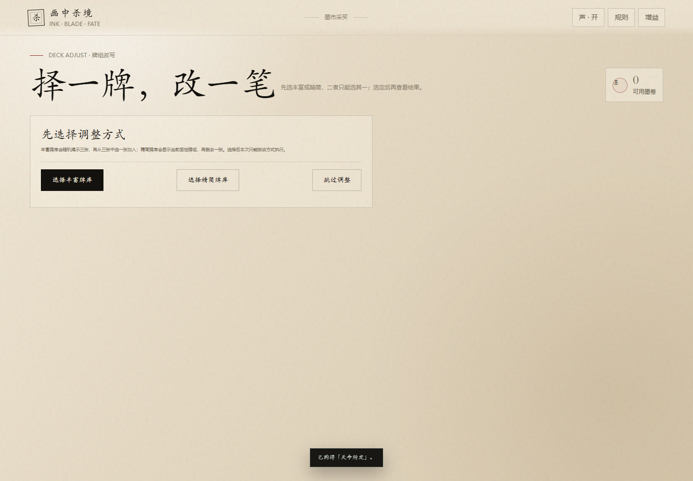

**丰富牌库：** 点击「选择丰富牌库」，随机揭示 3 张候选，再点击其中一张加入牌组。是增加一张牌，不是三张全拿；也可放弃本次调整。完成后自动进入下一关。

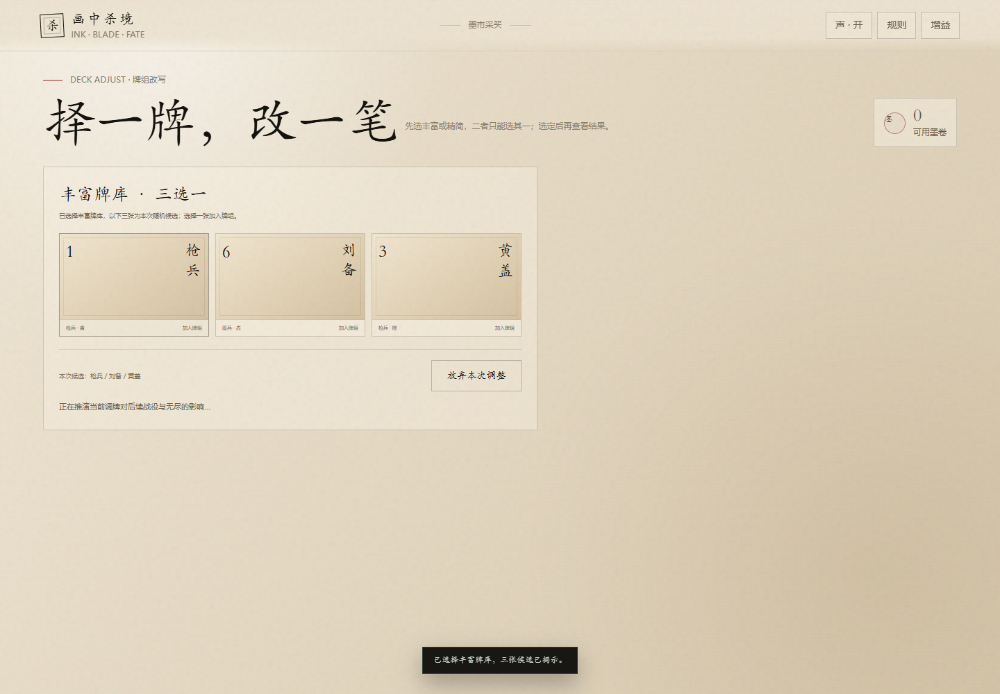

**精简牌库：** 点击「选择精简牌库」，查看当前固定牌组，找到不想保留的牌并点「删去」。只删一张，不是该名字的全部副本，也不能在这里随意增加数量。完成后进入下一关。

通关后继承的是牌组、增益与墨卷；新关卡重新建立本关战斗资源。飞将无双每轮结算后可再战无尽，不再按前八关的流程进墨市。

## 四、关卡辅助完整流程

### 1. 先对齐真实状态

首页点击「关卡辅助」。这个界面是本地参谋，不会连接、扫描或操控外部游戏进度。

1. 点「换关」选择实际关卡。换关会重置这次辅助试炼的得分、手牌与次数，原有牌组、增益和墨卷配置仍需核对。
2. 点「增益」核对已持有项目，不要勾选仅在商店里看到但未购买的项目。
3. 开始新一轮时使用「重开试炼」重置本关记录；它不是撤销上一手，点击前先核对。
4. 若中途接入，必须确认得分、剩余出牌与弃牌、增益、牌组历史均与实际一致。此版本没有任意完整存档导入功能；不能只换一张截图就声称所有历史自动同步。

### 2. 手动录入完整 8 张

首次进入会打开「同步当前手牌」，之后可点「同步手牌」再次打开。

1. 按真实牌面，在对应牌下点「＋」。同名多张要多点，不同兵种的青色牌不要混淆。
2. 录错点「−」；全部重录点「清空」。
3. 看底部计数，必须正好 **8 / 8**，才能「应用手牌」。
4. 点击「应用手牌」，确认牌名、兵种和重复数量；界面可能按自身排序展示，顺序与外部游戏不同并不表示识别错误。
5. 手牌应用后会自动生成参谋方案，计算完成前稍等。

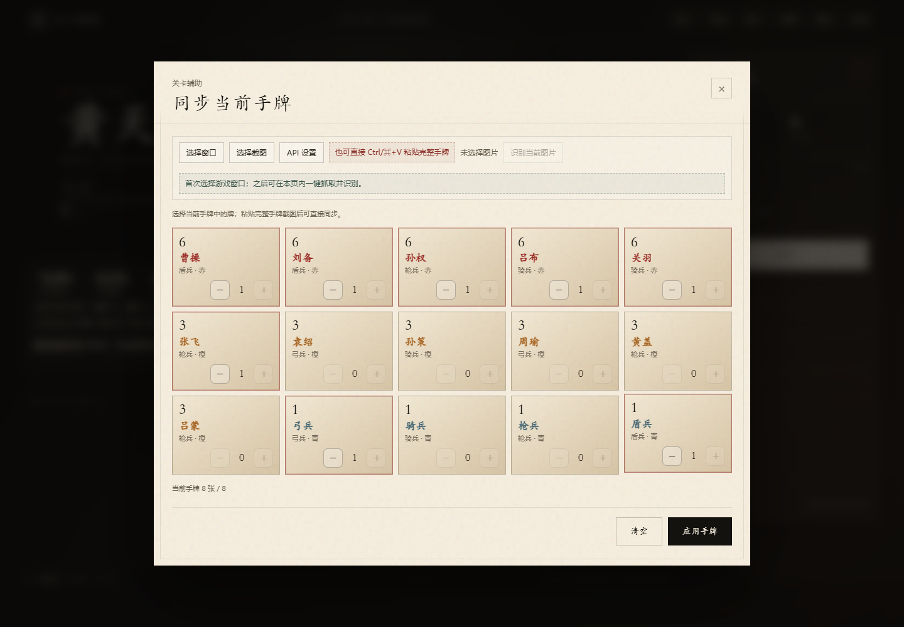

> 每次补牌后同步的是外部游戏此刻的**完整 8 张**，不是只录新抽出的几张。辅助工具会尝试对齐剩余牌池；提示数量不符时，应先核对录入与牌组历史，不要继续按错误状态计算。

### 3. 看推荐并执行

「参谋推荐」可能比较「直接出牌」与「弃牌再打」，给出伤害、路线收益、概率及推荐依据。

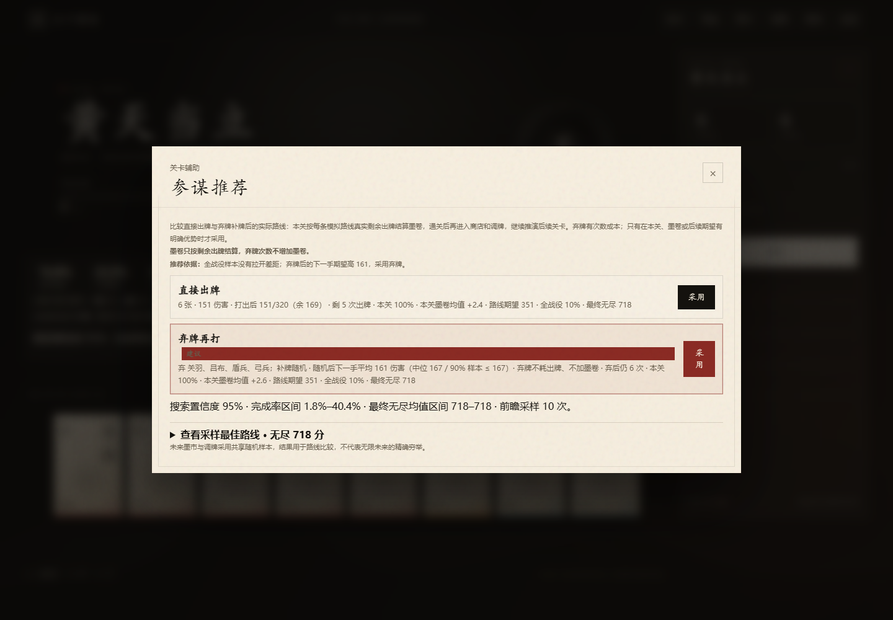

**直接出牌的顺序：**

1. 对应方案点击「采用」，它只选中辅助界面的牌。
2. 核对所选牌与预览，在外部游戏执行相同出牌。
3. 回工具点击「出牌」记录本次动作，工具扣次数并累计本地得分。
4. 外部游戏完成补牌后，再同步完整 8 张，继续下一手。

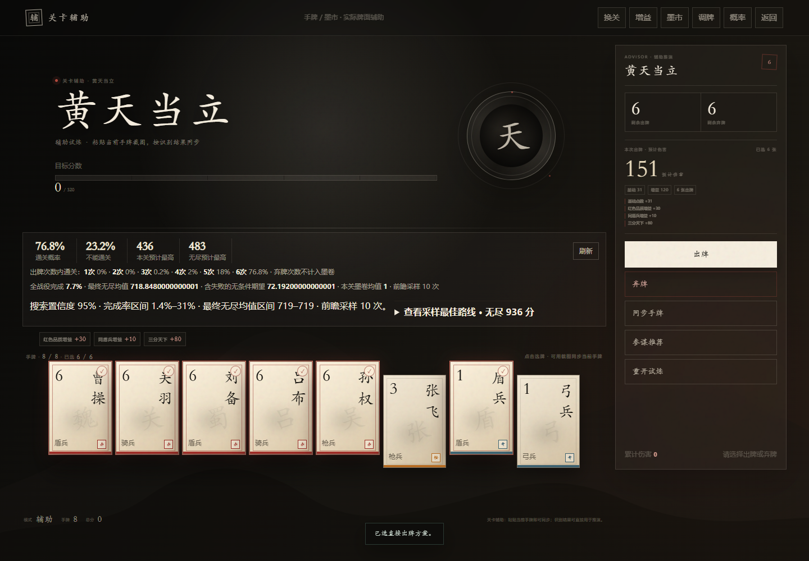

**弃牌的顺序：** 在弃牌方案点「采用」后，核对选中的牌，在外部游戏弃掉相同牌，再在工具点「弃牌」记账，最后同步完整 8 张。点击「采用」本身不消耗次数，也不会控制外部游戏。

不要对同一手重复点击记账。辅助界面还在等待补齐 8 张时，出牌 / 弃牌按钮可能不可用，这是同步要求。

## 五、辅助墨市与调牌

### 1. 墨市参谋

顶栏点「墨市」。它与试炼里的真实商店不同，这里的购买只计入参谋。

1. 输入外部游戏的「当前墨卷」。
2. 选择截图并识别，或展开「手动修正识别结果」。
3. 按画面顺序设置实际出现的三张增益及各自价格，不要把图鉴中的任意增益当成本轮商品。
4. 点击「重新计算」，等待购买组合与保留墨卷的方案比较。
5. 核对后点「选这张」「采用推荐」或「采用推荐 · 计入参谋」。
6. 在外部游戏中购买同名增益，并核对工具里的剩余墨卷和已持有增益。
7. 记错时用「撤销上次」，完成后进入「下一步 · 调牌参谋」或关闭。

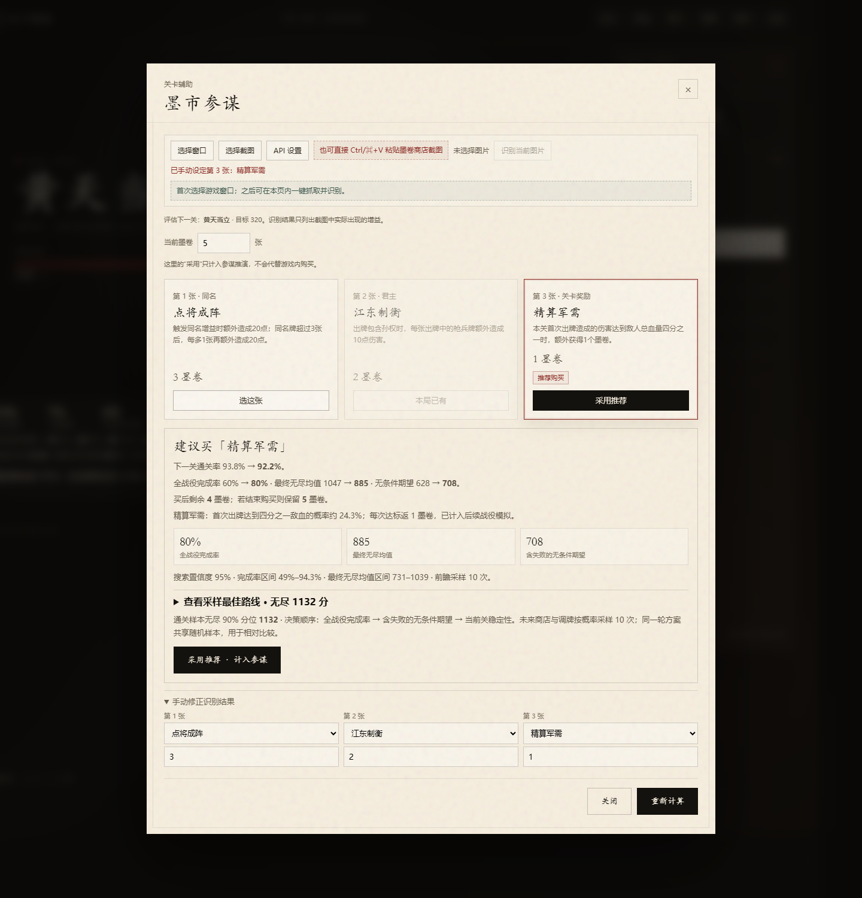

截图中的墨卷与候选为手动示例，不是从外部游戏自动读取。界面里即使出现「同步存档」字样，也不表示工具能自动读取另一款游戏；仍要逐项核对。

### 2. 调牌参谋

顶栏点「调牌」。先决定丰富还是精简，也可先用「比较选择方式」看估计。

**丰富：** 在外部游戏选择丰富并查看实际揭示的 3 张，再在这里用三个下拉框录入或识别截图。三张完整后会生成方案。点击「按推荐加入」只修改辅助牌组，仍需在外部游戏选同一张。

**精简：** 基于当前辅助牌组比较删牌方案，点击「按推荐删牌」记录删除一张。先确认当前牌组与真实牌组一致；不是任意编写牌库的编辑器。

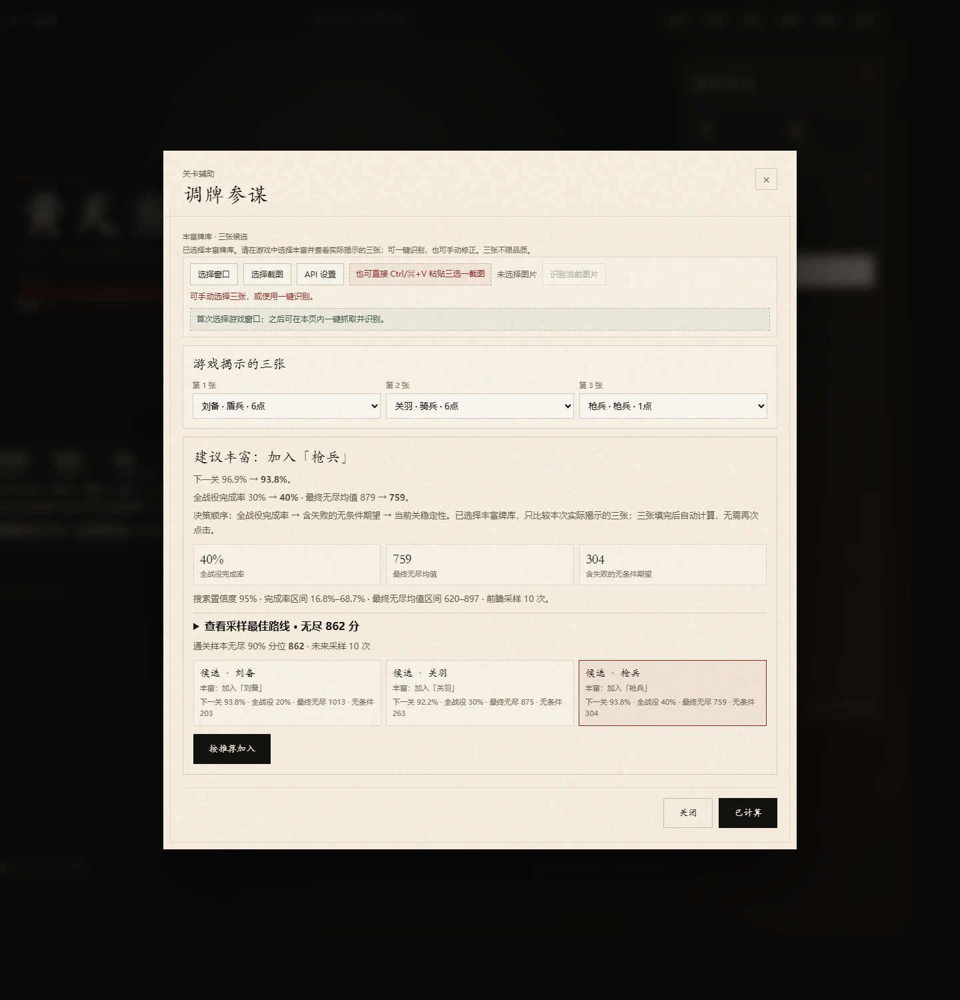

执行错了可用「撤销调牌」。进入后续关卡前，重新核对关卡、牌组、增益、墨卷与手牌，避免只更新其中一项。

## 六、截图识别与 API 设置

### 1. 哪些操作不需要 API

网页试炼、手动录入手牌、手动选择商店增益、手动输入丰富候选以及概率模拟，都可不配置 API。只有让工具理解截图时才需要兼容的图像模型服务。

### 2. 配置方法

从手牌同步、墨市或丰富候选的截图工具栏点击「API 设置」。

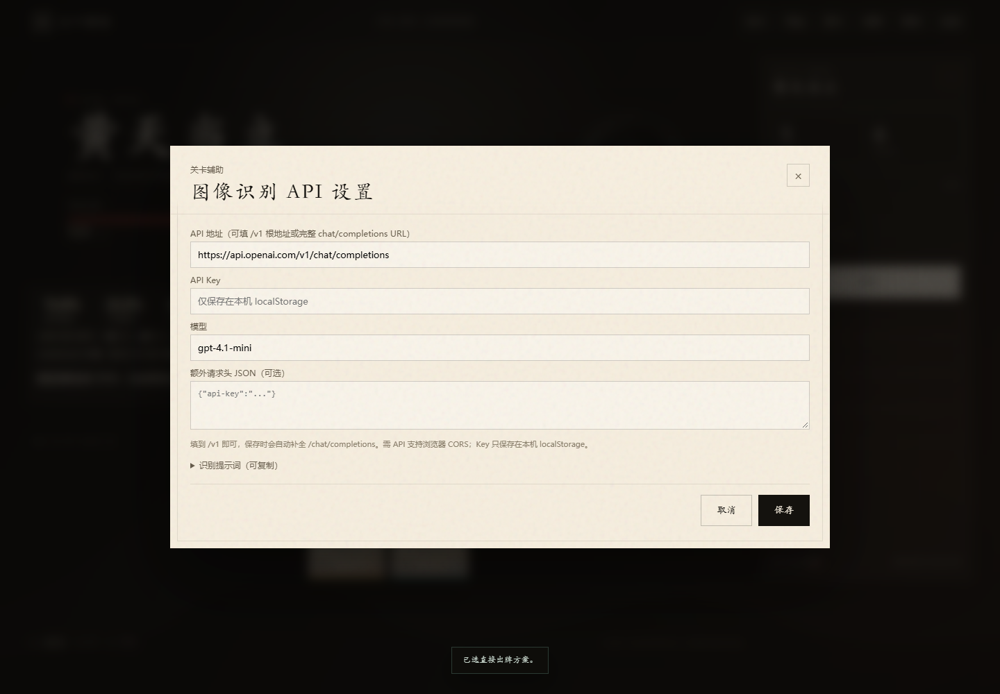

| 字段 | 填写方式与要求 |
| --- | --- |
| API 地址 | 你的服务提供商的 `/v1` 根地址或完整 `/chat/completions` 地址；保存时根地址会补全路径 |
| API Key | 自备的、受额度限制的密钥；不要发给他人或写入仓库 |
| 模型 | 服务商实际可用、支持图像输入的模型名 |
| 额外请求头 JSON | 非必填，按服务商要求填写合法 JSON；不要填带注释或单引号的对象 |
| 识别提示词 | 可展开查看 / 复制，用于了解期望的识别内容 |

界面预填的 `gpt-4.1-mini` 只是这个 HTML 内置的默认文本，不代表当前最新模型或你的账号一定有权限。此工具按 Chat Completions 风格提交包含图像的请求；不是任意 OCR 地址都能直接替换使用。

确认字段后点「保存」。服务还必须允许浏览器 CORS；仅能在服务器调用、缺少图像能力或响应结构不兼容的服务不能直接使用。HTTPS 页面不要配置不安全的 HTTP 服务地址。

### 3. 三种截图输入

| 方式 | 操作 |
| --- | --- |
| 文件 | 点击「选择截图」，选择图片，再点「识别当前图片」 |
| 粘贴 | 先在系统截图，把图片复制到剪贴板，回本页按 Ctrl+V；macOS 为 Command+V，再识别 |
| 窗口共享 | 点击「选择窗口」，在浏览器 / 系统弹窗选择游戏窗口并授权；选错用「重选窗口」 |

窗口流有效时按钮会变成「一键识别当前窗口」，它会抓取并调用识别服务，不只是预览。每次识别可能产生服务费用。不要将整个桌面上的聊天、账户资料或真实密钥一起截入。

识别后务必人工核对：手牌是否恰好 8 张、同名张数、青色兵种；商店增益名称、价格、墨卷；丰富候选是否与实际三张一致。修正后再应用或重算。

### 4. 隐私与密钥

- 识别请求由浏览器直接发给配置的 API 服务，图像以请求数据发送；不是发给 GitHub 帮你识别。
- 手动录牌无需上传图片。托管页面本身的访问请求与图像识别请求是两回事。
- API Key 保存在本机浏览器 `localStorage`，不是加密保存。共享设备上不建议保存，必要时用完清空 Key 后保存。
- 不要把密钥写进 `index.html`、README、额外请求头示例、GitHub Issues 或操作截图。泄露后应在提供商处撤销 / 轮换，删除文本不等于撤销。
- 截图不清晰、权限取消、超时或接口报错时，可随时回退为手动录入。没有 API 不影响基础试炼。

## 七、概率与推荐怎么看

点击顶栏「概率」（试炼顶栏为「参谋」），再点「开始估算」。模拟在浏览器本地运行，复杂方案可能暂时占用较多 CPU，耗时随设备变化，不保证页面提示的秒数。

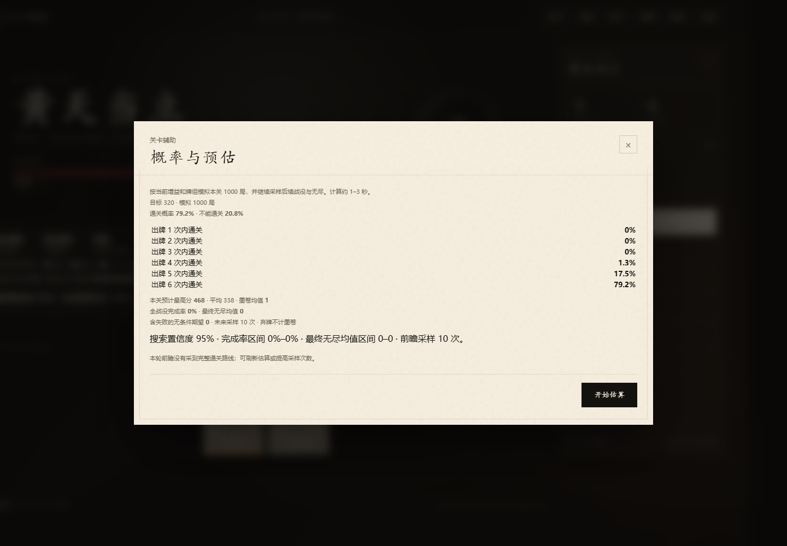

| 指标 | 正确理解 |
| --- | --- |
| 本关通关概率 | 当前牌组与增益下模拟得到的成功比例，不是必过承诺 |
| 出牌次数内通关 | 在对应次数内达标的累计模拟比例 |
| 本关 / 无尽预计最高 | 有限样本中的高分或估计，不是数学理论上限 |
| 全战役完成率 | 继续模拟后续关卡、随机墨市和调牌后的估计完成比例 |
| 最终无尽均值 | 完成战役样本的无尽收益；要结合完成率一起看 |
| 含失败的无条件期望 | 将失败情形也计入的收益指标，用于避免只看成功样本 |
| 置信区间与前瞻采样 | 有限抽样的不确定性提示，区间宽说明结论应谨慎 |

随机模拟会波动；相同牌面重新计算也可能改变建议。前瞻样本较少时，显示 0% 只是当轮没有采到成功路线，不等于已证明不可能；100% 也不意味着真实游戏保证成功。某些概率总览基于整副牌，当前手牌方案则使用当前已知状态，不能把两者当成同一个指标。

手牌、增益或墨卷变化后应重新核对并刷新相应估计。不要以截图里的示例数值代替自己的实际计算结果。

## 八、存档、手机与常见问题

### 1. 存档

进度存在当前浏览器的 `localStorage`，应用存档键为 `huazhong-shajing-v2`，API 设置键为 `yanwuVisionConfig`。

普通刷新可恢复未结束的战斗、牌组、增益、墨卷和辅助状态。本次已实测加牌后 45 张牌组、第二关与增益刷新后保持一致。但商店报价与所有临时弹窗并未作为完整快照保存，**不要依赖刷新保留同一组随机商品**。

更换设备、浏览器、无痕窗口、站点协议 / 主机 / 端口，或从本地文件切换在线版，存档不保证互通。清除站点数据会删除进度与 API 设置。此版本未提供一键云同步或官方存档导出入口；重要进度先截图记录。

### 2. 手机使用

用手机浏览器打开相同在线地址，点按选牌和加减数量；长页面与弹窗可滚动。辅助录牌、试炼可使用，窗口共享与剪贴板能力以手机浏览器支持情况为准，识别受限时用上传截图或手动录入。

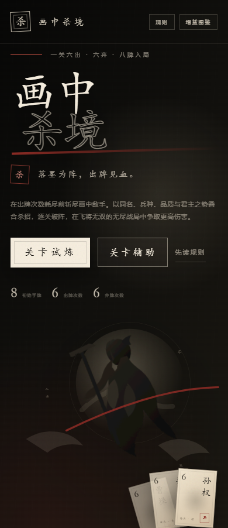

### 3. 常见问题

| 现象 | 检查与处理 |
| --- | --- |
| 出牌按钮不可用 | 是否已选 1 至 6 张，是否还有次数，辅助是否正好 8 张，上一手是否已结算 |
| 应用手牌不可用 | 录入数量是否正好 8 张，重复牌是否按张数计入 |
| 预计伤害与外部游戏不同 | 核对牌名、兵种、已持有增益、阶段性触发与历史状态；本 HTML 规则也可能与外部版本不同 |
| 点击采用没有在游戏里出牌 | 正常，采用仅选择工具中的牌；外部游戏必须手动执行 |
| 弃牌后墨卷没有增加 | 正常，普通通关奖励只按剩余出牌，不按剩余弃牌 |
| 墨市提示余额不足 | 先核对墨卷，再按实际价格选择；辅助中修改余额只是录入，不会给游戏增加货币 |
| 识别按钮不可点 | 先选择 / 粘贴图片，或完成窗口选择 |
| 401 / 403 | 检查密钥、模型权限和服务商限制，不要公开贴出完整密钥 |
| 429 | 检查服务额度或频率，稍后重试，避免连续点击 |
| 网络、CORS、超时 | 检查接口路径、HTTPS、图像能力与浏览器跨域允许；必要时改用兼容服务或手动录入 |
| 概率一直算或页面短暂卡顿 | 等当前模拟完成，减少连续操作，关闭其他高负载页；刷新前考虑临时商店状态可能不保留 |
| 找不到原存档 | 回原浏览器和原入口，不要立即清除数据或重开战役 |
| 没有声音 | 点「声 · 开 / 关」，核对浏览器声音权限和系统音量 |

## 九、GitHub 发布与后续更新

### 1. 本次发布结构

仓库为 **`CharlesWang505/huazhong-shajing-web`**，独立于其他技能项目。入口使用 `index.html`，原《画中杀境.html》未改写；`.gitattributes` 避免 Git 自动转换入口文件换行。

```text
huazhong-shajing-web/
  index.html
  .nojekyll
  .gitattributes
  .gitignore
  README.md
  docs/
    操作手册.md
    images/
```

### 2. GitHub 网页下载与查看

打开仓库，README 可以直接点击图文手册。要下载整个项目，在绿色 **Code** 菜单中点击 **Download ZIP**，解压再打开 `index.html`。

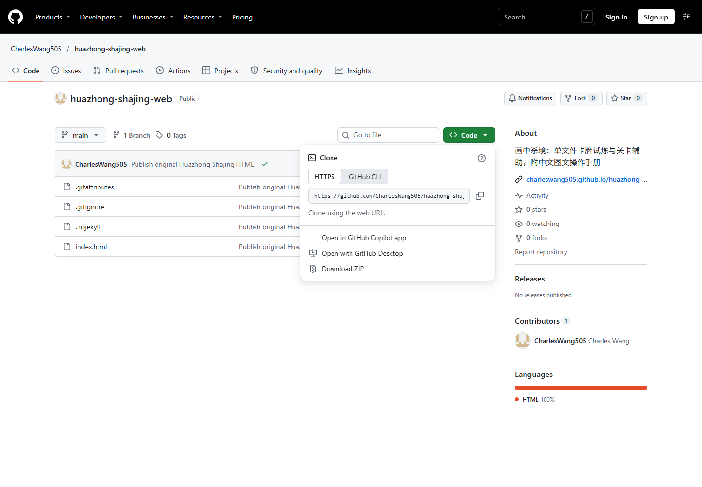

### 3. Pages 发布配置

仓库所有者登录 GitHub 后进入 **Settings → Pages**：

1. Source 选择 **Deploy from a branch**。
2. Branch 选择 **main**，目录选择 **/ (root)**，保存。
3. 到 **Actions** 查看 `pages build and deployment`，等待构建与部署都成功。
4. 打开在线地址，核对首页与核心操作。首次部署或更新后可能需要等待缓存更新。

本次已配置为 `main` 根目录发布，不需要安装依赖或手动构建。

### 4. 网页方式更新

1. 先备份新版本 HTML，不要上传真实存档、API Key 或其他私人文件。
2. 将准备发布的文件命名为 `index.html`。
3. 仓库 **Add file → Upload files**，上传这个文件，确认只替换预期内容。
4. 写明更改说明，提交到 `main`。
5. 等待 Actions 中 Pages 部署成功，再访问在线页验证。
6. 功能或按钮改变时，同步更新本手册和相应截图，保持 `docs/images/` 的文件名与引用一致。

不要只上传名为《画中杀境.html》的新文件而忘了替换 `index.html`，否则默认在线入口仍然是旧版本。

### 5. 命令行方式更新

适合已配置 Git 与 GitHub 登录的电脑。以下命令针对单独克隆的发布仓库，不是在其他项目根目录执行全量上传。

```powershell
git clone https://github.com/CharlesWang505/huazhong-shajing-web.git
Set-Location huazhong-shajing-web
Copy-Item -LiteralPath 'F:\yanwu-tool\画中杀境.html' -Destination '.\index.html'
git status --short
git diff --stat
git add -- index.html
git commit -m "Update game page"
git push origin main
```

若已有克隆，先在该仓库检查本地更改，再 `git pull --ff-only`。有未提交修改或分叉时先处理，不使用强制推送或硬重置覆盖他人改动。文档与截图有更新时，检查后单独 `git add -- README.md docs`。

### 6. 回退、删除与权限

页面更新出错时，保留错误现场，使用 GitHub 的历史记录找到正确版本；优先用新的回退提交恢复，不直接重写公开分支历史。删除仓库、改变可见性、添加许可证或自定义域名属于另外的管理操作，不是更新 HTML 的必要步骤。

GitHub 官方参考：[Pages 发布来源设置](https://docs.github.com/en/pages/getting-started-with-github-pages/configuring-a-publishing-source-for-your-github-pages-site)、[下载源代码压缩包](https://docs.github.com/en/repositories/working-with-files/using-files/downloading-source-code-archives)。

## 十、验证范围

本次实际操作覆盖：首页、规则、增益图鉴、战役画卷、选牌与预览、第一关通关、墨卷结算、购买特殊增益、丰富牌库三选一、进入下一关、刷新恢复、辅助手动同步 8 张手牌、采用与出牌记账、墨市和调牌参谋、概率估算，以及桌面 / 手机视口。

截图使用独立测试浏览器，不包含个人密钥。未发起真实付费图像识别请求；窗口授权、特定提供商 CORS 与真实 OCR 准确率需在你自己的服务和设备上验证。未把所有增益组合、完整九关与每种异常场景都声明为通过。
